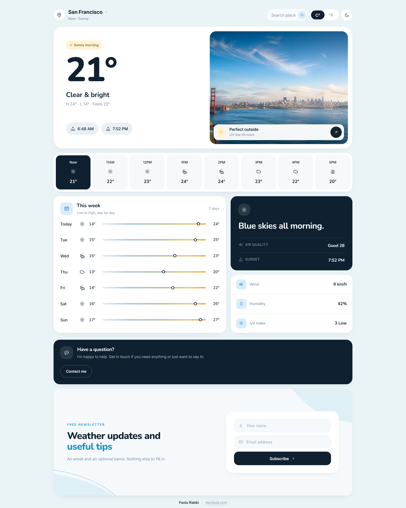
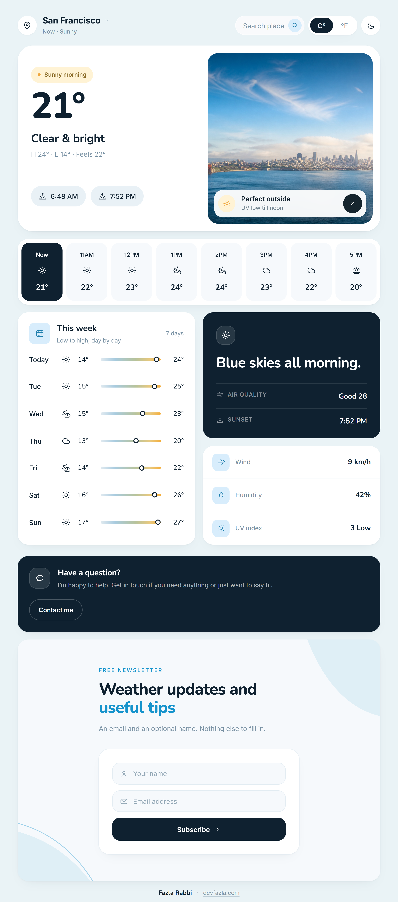
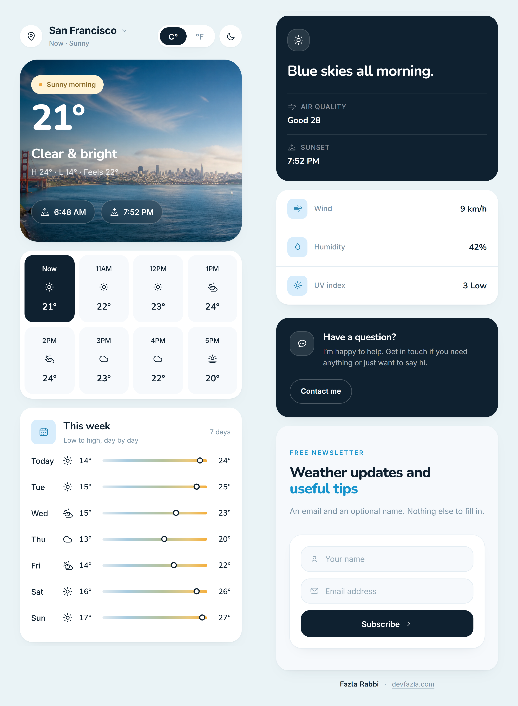

# Weather Dashboard

A weather dashboard built with React, TypeScript and Tailwind CSS v4. Live conditions, hourly and 7-day forecasts, air quality and UV data all come from [Open-Meteo](https://open-meteo.com/). First load places the visitor by IP, and if the network fails the last snapshot stays on screen. A contact page, a newsletter field in the footer and a traffic counter sit on the same small serverless backend, with Telegram as the only store.

| Desktop | Tablet | Mobile |
| --- | --- | --- |
|  |  |  |

## Features

- Current conditions with feels-like, sunrise/sunset and today's high/low.
- The next 8 hours in one row, with each hour's temp and a WMO-mapped icon. On a phone it becomes two rows of four.
- A 7-day outlook of min/max range bars, with each day's high placed inside the week's spread.
- The spotlight card beside it: one headline written from the numbers, then air quality and sunset as two labelled rows. Nothing else, the card is three lines of text.
- Wind, humidity and UV index as three rows in one panel, all derived from the same response.
- Search any city (debounced geocoding) or use the device's GPS position, which is reverse-geocoded back to a city name.
- New visitors get placed by IP. From then on whatever they picked is what loads.
- °C / °F without a refetch, since the API is queried in Celsius either way.
- Light and dark themes are token-driven and applied through a `dark` class on `<html>`.
- A built-in sample snapshot paints the layout instantly and survives failed requests; the footer offers a retry.
- `/contact` is a proper route: a validated form that posts to the bot, beside a rail carrying the direct address as a draft prefilled from what has been typed, the social profiles as marks only, and three lines on what makes a message fixable.
- The newsletter signup in the footer takes an email and an optional name. Subscribers land in the same chat as the contact messages.
- Pageviews, sessions, countries, referrers and device classes, readable back as JSON from `/api/stats`.

## Tech stack

| Layer | Choice |
| --- | --- |
| UI | React 19, function components and hooks only |
| Routing | React Router 7, two routes in one document |
| Language | TypeScript 5.9 (`strict`, `noUnusedLocals`, `noEmit`) |
| Build | Vite 7 with `@vitejs/plugin-react` |
| Styling | Tailwind CSS v4 via `@tailwindcss/vite` (no `tailwind.config.js`) |
| Data | Open-Meteo forecast, air-quality and geocoding APIs |
| Backend | Vercel functions in `api/`, Telegram Bot API as the store |
| Storage | `localStorage` for the chosen place, IP placement and response cache; `sessionStorage` for the visit id |

There is no state manager, data-fetching library or UI kit. The app is one dashboard, one contact form and a handful of hooks.

## Getting started

```bash
npm install
npm run dev      # http://localhost:5173
```

| Script | Description |
| --- | --- |
| `npm run dev` | Start the Vite dev server with HMR |
| `npm run build` | Type-check (`tsc --noEmit`) then build to `dist/` |
| `npm run preview` | Serve the production build locally |

No API key is required for the forecast: every Open-Meteo endpoint is public and keyless. Because geolocation requires a secure context, the "My location" button only works over HTTPS or `localhost`.

The forms and the counter do need a Telegram bot. Copy `.env.example` to `.env.local` and fill it in:

| Variable | Required | Purpose |
| --- | --- | --- |
| `TELEGRAM_BOT_TOKEN` | yes | Token from [@BotFather](https://t.me/botfather) |
| `TELEGRAM_CHAT_ID` | yes | Chat, group or `@channel` that receives contact messages and signups |
| `TELEGRAM_ANALYTICS_CHAT_ID` | no | Where the counters and error reports go; defaults to `TELEGRAM_CHAT_ID` |
| `ANALYTICS_SALT` | no | Salt for the hashed visitor IP shown in the messages |
| `STATS_TOKEN` | no | Enables `GET /api/stats`; without it the endpoint answers 501 |

A small Vite plugin mounts the `api/` handlers on the dev and preview servers, so `npm run dev` exercises the real functions with the variables above coming from `.env.local`.

## Architecture

```
src/
├── main.tsx                 # BrowserRouter, routes, scroll reset, pageview + error hooks
├── App.tsx                  # Dashboard layout, unit + theme state, dialog wiring
├── pages/ContactPage.tsx    # /contact, its own head tags and schema
├── pages/NotFoundPage.tsx   # every other path, noindex and a link home
├── components/              # Presentational: Header, HeroCard, HourlyStrip,
│                            # WeekForecast, HighlightsCard,
│                            # MetricCard, LocationDialog, Footer, Snackbar, icons
├── data/weather.ts          # View-model types, default place, fallback snapshot
└── lib/
    ├── openMeteo.ts         # URL builders, WMO mapping, response -> Weather
    ├── useWeather.ts        # Active place + fetch lifecycle (loading/ready/error)
    ├── cache.ts             # localStorage cache with in-flight de-duplication
    ├── location.ts          # IP detection, saved place, reverse geocoding
    ├── format.ts            # °C/°F, clock labels, weekday, UV buckets
    ├── heroImage.ts         # WMO code + hour + temperature -> hero scene
    ├── theme.ts             # light/dark preference
    ├── seo.ts               # document title/description/canonical per route
    ├── ui.ts                # shared field, label and hint classes
    ├── api.ts               # fetch wrappers for /api, beacon for pageviews
    ├── snackbar.ts          # one-off result messages: store, tone, auto-dismiss
    └── analytics.ts         # visit id, opt-out rules, pageview + error caps

api/
├── _shared.ts               # Telegram call, escaping, reply helpers, clientInfo
├── _stats.ts                # the pinned-message counters (read, bump, write)
├── contact.ts               # POST /api/contact
├── subscribe.ts             # POST /api/subscribe
├── track.ts                 # POST /api/track
├── report.ts                # POST /api/report
└── stats.ts                 # GET  /api/stats (token-guarded)
```

The data flow is one-directional. `useWeather` owns the place and the current snapshot, every API translation happens in `openMeteo.ts`, and components receive a fully-formed `Weather` object. Nothing in `components/` knows about URLs, caching or error handling, which keeps the layout easy to restyle.

### Data pipeline

1. `useWeather` resolves a place. Saved choice first, then an IP lookup, then `defaultPlace` (San Francisco).
2. `fetchWeather` requests `/v1/forecast` and `/v1/air-quality` in parallel. Air quality is best-effort and degrades to "unavailable".
3. `buildWeather` collapses the response into the `Weather` view model. It locates "now" by string-matching wall-clock timestamps (the API returns the location's own timezone), maps WMO codes onto four glyphs, buckets UV and AQI, and writes the spotlight headline from those numbers.
4. The previous snapshot stays mounted while a new one loads, so the dashboard never flashes a skeleton.

## Contact, newsletter and analytics

There is no database. Telegram is the backend: the functions in `api/` hold the bot token server-side and talk to the Bot API.

| Endpoint | What it does |
| --- | --- |
| `POST /api/contact` | Validates name, email and message, then sends a formatted message to `TELEGRAM_CHAT_ID`. Answers 502 on failure so the page can offer a `mailto:` draft. |
| `POST /api/subscribe` | One message per signup: name when given, email, source, location, device and hashed IP. |
| `POST /api/track` | Counts a pageview: views, sessions, country, path, referrer and device class. |
| `POST /api/report` | Client-side errors, the same stream as the traffic notices. |
| `GET /api/stats` | The counters as JSON, with named top countries, paths and sources. Requires `STATS_TOKEN`. |

### How the messages read

Every submission is built by the same helpers in `api/_shared.ts`, so the four templates share one shape. An emoji-headed title line, then the person, the content, two italic meta lines and one-tap buttons.

```text
✉️ New enquiry

Ada Lovelace · ada@example.com

❯ Sylhet reads 4° too high in the evening.
  The same hour in Dhaka looks right.

🇧🇩 Sunamganj, Sylhet, Bangladesh · Mobile · Safari on iOS
9f2c1a… · 14:28 UTC · /contact

[ 🌐 Open the page ]
```

- The body sits in a `<blockquote>`, which Telegram draws with a rule down the left, so it reads as a quote instead of blending into the header.
- The address is the reply link and carries its own `mailto:` subject, which means one tap on it opens a prefilled draft. Buttons cannot take the mail route: Telegram wants HTTPS there and answers `BUTTON_URL_INVALID` by failing the whole message, so `sendMessage` drops any other scheme instead of losing the submission.
- One button per row, and they only ever point at a page. Side by side they truncate.
- The meta line is location · device · browser, then the hashed IP, a UTC timestamp and the context (which page, which form, which route errored). `trace()` splits and de-duplicates the place parts, so "Sylhet, Sylhet, Bangladesh" never prints twice.
- Link previews are off. A contact message is not a card, and a preview of the dashboard underneath it would be noise.
- Telegram's HTML subset is small (`b i a code pre blockquote`), which is why the layout leans on blank lines and one emoji per heading rather than styling.
- A slow Telegram does not swallow the message. Every call gets 6 s and one retry on a fresh connection, because a long-lived dev server can hold a keep-alive socket to an address Telegram has stopped using and only a new connection cures it. A refusal (`4xx` from Telegram) is never retried, since that is an answer rather than a silence. A retried send can duplicate a message that did arrive, and a second copy in the chat costs less than a lost enquiry. Both attempts fit inside Vercel's default 10 s function budget, and the visitor's own fallback is the `mailto:` draft the contact page offers on failure.

### The counters live in a pinned message

`api/_stats.ts` reads the document out of the chat itself. `getChat` returns `pinned_message`, the JSON inside its `<pre>` block is parsed, incremented and written back with `editMessageText`. The first write sends the message and pins it. The readable summary above the JSON is regenerated every time; if the text ever approaches Telegram's 4096-character limit, the summary is dropped and only the JSON is kept.

- The bot has to be an admin in the analytics chat. Pinning and editing are admin actions, and without them the counters stay at zero.
- Writes are serialised per chat inside a function instance and retried when Telegram asks for a slower rate, so a burst of visits does not lose counts to a read-modify-write race.
- Country names come from `Intl.DisplayNames`. An unknown code reads as "Unknown", which is what visitors on a network without geo headers get until the browser reports its own placement (see below).

### What is counted, and what is not

- One pageview per route per tab. The visit id lives in `sessionStorage`, so a reload is not a new reader, while `/` to `/contact` counts as two views and one session.
- Country, region and city come from Vercel's edge headers first. Where those are absent (local dev, a preview, a self-host) the browser sends the placement its own IP lookup already produced, so the messages still name a country. Anything the client claims is a guess rather than a fact: it is length-capped, and only a two-letter value is allowed to become a country code.
- Bots are dropped. A request whose `User-Agent` looks like a crawler gets a 204 and changes nothing.
- Rate limits: 750 ms between pageviews per IP, 10 to 20 s between form submissions, and capped maps (60 countries, 25 paths, 15 sources, 4 devices) to keep the document small.
- Opting out works. `navigator.doNotTrack`, Global Privacy Control or `?noanalytics` in the URL stops the client from sending anything at all.
- The IP itself is never stored. The messages show a salted SHA-256 prefix, enough to tell two visitors apart and nothing more.

```bash
# the live numbers, once STATS_TOKEN is set
curl -H "Authorization: Bearer $STATS_TOKEN" https://weather.devfazla.com/api/stats
```

### Caching

`cachedJson` wraps `localStorage` with per-product TTLs and a shared `Map` of in-flight requests:

| Request | TTL |
| --- | --- |
| Forecast | 10 minutes |
| Air quality | 30 minutes |
| Geocoding | 24 hours |
| IP placement (separate key) | 24 hours |

Coordinates are rounded to ~1 km before being used as a cache key, which matches the model grid and keeps reloads from burning the free tier's 10,000 calls/day. An aborted request rejects for that caller only, while the shared fetch still completes and warms the cache. If a request fails, the expired entry is returned instead of an error.

## Design system

Tokens live in `src/index.css` and are exposed to Tailwind through `@theme inline`, so `bg-card`, `text-muted-foreground`, `rounded-xl` and friends all resolve to CSS variables. Adding a theme means editing the `:root` / `.dark` blocks, not class strings.

- Palette: soft sky background, white cards, `--primary` blue, `--sun` amber for warm accents.
- Radii are 10 / 16 / 22 / 32 px (`sm` / `md` / `lg` / `xl`).
- Inter for UI, Nunito for the hero temperature.
- `animate-rise` staggers the cards in and `animate-pop` handles the location dialog and the snackbar.
- The spotlight card and the contact panel share one dark surface, `bg-ink-soft` with white text, warmed by a radial amber wash off the top edge. The card holds one headline and two rows and stops there: an earlier version carried a "Best time" label, a second headline line about golden hour and a tip paragraph, and all three restated something already on the page. Inside the rows the labels recede to 50 percent white and the readings carry the weight. The newsletter band under them is light: `bg-card-soft`, two pale `--primary` washes in the corners, the lower one edged by a hairline curve drawn in one inline SVG, and the signup fields lifted into a white card on top of it.
- A form's result floats in a snackbar fixed to the bottom of the viewport instead of pushing layout around inside the footer. `src/lib/snackbar.ts` keeps one message at a time (4.5 s for a success, 8 s for a failure that carries a link to act on), and the pill is `role="status"` or `role="alert"` so a screen reader hears which is which. A rejected email leaves nothing behind but `aria-invalid` on the field it belongs to.
- UI glyphs are drawn by hand in `src/components/icons.tsx` on a 24 px grid with a 1.6 stroke. The four brand marks on `/contact` are the exception: official paths, filled and set to `currentColor`, because each network's own blue and black would fight the theme and a hand-simplified cat silhouette is worse than no cat.

## Responsive behaviour

- Mobile is a single column with everything stacked. The hero photo becomes the background of the temperature block instead of sitting next to it, and the note chip over the photo waits for `md`, where there is a photo beside the text again. The hourly row wraps into two rows of four so no hour is hidden behind a scroll.
- At `md` the hero and strip stay full width while the week list and the right rail split into two columns. The rail stacks the spotlight card over the metrics panel, and each of them keeps the height its own content asks for.
- At `xl` the grid is 12 columns, 7 for the week list and 5 for the rail. Wind, humidity and UV share one panel instead of three separate cards, so the rail reads as two blocks rather than four.
- The footer is two sections, contact and newsletter, stacked one under the other at every width and each full width of the page. Inside the newsletter band the copy and the form card sit one after the other until `xl`, where they split into a left column and a fixed 400 px column on the right. The card stops at 400 px rather than spanning the band, and the name field, the email field and the Subscribe button run down that width, so the button matches the fields above it. Sections keep their natural height, and every field can give way before its container does, so nothing pushes the page sideways at 320 px.
- `/contact` is one column until `lg`, where the form takes 7 of the 12 columns and the rail 5. Name and email share a row from `sm`, and the message, the chips and the button stay full width, since those are the parts that read badly when halved. The rail is `sticky` inside a `self-start` column: its two cards end level with the form card at rest, and a message box dragged taller scrolls past them while the rail holds 24 px under the top edge, then lets go at the bottom of the column and the rest of the page moves with it. `my-auto` centres the pair on a tall screen without ever clipping the top of the form.

## Deployment

The repo ships with `vercel.json`, so importing it at <https://vercel.com/new> needs no dashboard settings:

| Setting | Value |
| --- | --- |
| Framework | `vite` |
| Install command | `npm ci` |
| Build command | `npm run build` (`tsc --noEmit` then `vite build`) |
| Output directory | `dist` |
| Node | 22, from `.nvmrc` |

1. Import the GitHub repo. The build settings above come straight from `vercel.json`.
2. Under **Settings → Environment Variables**, add `TELEGRAM_BOT_TOKEN` and `TELEGRAM_CHAT_ID`, plus `TELEGRAM_ANALYTICS_CHAT_ID`, `ANALYTICS_SALT` and `STATS_TOKEN` if you want them. The functions in `api/` are picked up automatically; nothing needs wiring in the dashboard.
3. Make the bot an admin in the analytics chat and send it one message, so it is allowed to post, pin and edit.
4. Under **Settings → Domains**, add `weather.devfazla.com` and create the DNS record Vercel asks for.
5. Pushes to `main` deploy to production; pull requests get preview URLs.

`/contact` is a client-side route, so `vercel.json` rewrites it to `index.html`. A hard refresh gets no 404, and `cleanUrls` keeps the URLs extensionless. Nothing rewrites unknown paths to the app on purpose: a garbage URL should answer 404 rather than serve the dashboard with a 200, which is what a soft 404 looks like to a crawler.

`vercel.json` also sets the response headers:

- A **Content-Security-Policy** locked to `'self'` plus the API and font hosts the app actually calls. It has to keep `style-src 'unsafe-inline'`, because the cards position themselves with inline `style` attributes. `form-action 'none'` is deliberate: both forms post with `fetch`, and the `mailto:` fallback opens the mail client instead.
- **Strict-Transport-Security**, **X-Content-Type-Options**, **X-Frame-Options**, **Referrer-Policy**, and a **Permissions-Policy** that still allows geolocation for the location dialog.
- Hashed `/assets/*` are `immutable` for a year. The hero photos, `og.jpg` and the touch icon get a week with `stale-while-revalidate`.

## SEO

Everything a crawler or a social embed reads is static in `index.html`:

- Title, description, canonical (`https://weather.devfazla.com/`) and a `robots` meta that allows large image previews.
- Open Graph and Twitter tags pointing at `public/og.jpg`, a 1200×630 capture of the real card with the brand line baked in.
- A JSON-LD `@graph` describing the `Organization` (devFazla, with `sameAs` for the four social profiles), the `WebSite`, and the app itself as a free `WebApplication`.
- `<noscript>` copy, so the page still says what it is without JavaScript.
- One `<h1>`: the visually hidden `{city} weather` in the header, followed by the card `<h2>`s.
- `public/robots.txt`, which allows the site and keeps `/api/` out of the crawl, and `public/sitemap.xml` for the two indexable URLs.
- `public/404.html`, a standalone page with no bundle behind it, so an unmatched path gets a branded answer instead of the platform default. It carries `noindex, follow`.
- `src/pages/NotFoundPage.tsx` on the `*` route says the same thing inside the app, for a bad path that reaches the bundle rather than the edge. `usePageMeta` swaps the `robots` tag to `noindex, follow` while it is up and puts the original back on the way out.
- Preconnects to the forecast and font hosts, and `fetchpriority="high"` on the hero photo, which is the LCP element.
- Two `theme-color` tags, one per scheme, matching `--background` in each mode.

At runtime `src/lib/seo.ts` rewrites the title and description once live data lands, so the tab and the search snippet name the city and its conditions instead of the placeholder copy. The same hook gives `/contact` its own title, description, canonical and `ContactPage` JSON-LD, then restores the dashboard's head when you navigate back.

After the first deploy, add the property in Google Search Console and submit `https://weather.devfazla.com/sitemap.xml`.

## Credits

Built by [devFazla](https://devfazla.com/).

## Notes and limits

- Units toggle on the client. The WMO condition text and the wind speed (km/h) are not unit-converted.
- The hero photo follows the weather rather than the place. `src/lib/heroImage.ts` maps the WMO code, day/night and current temperature onto one of nine scenes (sunny, hot, partly cloudy, overcast, rain, storm, fog, snow, night). Bright scenes carry a heavier scrim so the copy, the note chip and the credit stay readable.
- The scene photos live in `public/hero-*.jpg`, cropped to 4:3. Files under CC BY / CC BY-SA show a credit chip that links back to Wikimedia Commons; CC0 and public-domain files do not. `hero-sf.jpg` is also the fallback when an image fails to load.
- Air quality and IP placement are best-effort. Failures degrade silently instead of blocking the dashboard.
- The project targets a modern browser (ES2022, `Google Fonts`, `localStorage`, `AbortController`).

Weather data by [Open-Meteo](https://open-meteo.com/) (CC BY 4.0). Reverse geocoding by [BigDataCloud](https://www.bigdatacloud.com/); IP placement by [ipwho.is](https://ipwho.is/) with [GeoJS](https://www.geojs.io/) as fallback.
